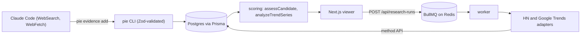

# Product Intelligence Engine

*An evidence ledger for ecommerce product research: an agent records sourced observations, and a scoring engine refuses to call a product promising without independent, measured proof.*


Product research tools tend to show sales and revenue estimates that nobody can trace. This project takes the opposite position: every claim it displays is an observation with a source, a URL, a timestamp and the method that produced it, and a metric that was never measured is shown as `UNKNOWN` with a reason. It does not estimate sales, revenue, trend growth or margin.

Discovery is done by Claude Code. Following `AGENT_PLAYBOOK.md`, it searches the public web and records each finding through a Zod-validated CLI, `pie`, which writes to Postgres. Two automated adapters (Hacker News and Google Trends) write to the same ledger. A Next.js app reads the ledger and shows candidates, verdicts, evidence and gaps.

The verdict logic is deliberately strict. A candidate is `PROMISING` only when at least two independent sources each contributed a measured metric. One source is `WEAK`. Claims without numbers are `UNVERIFIED`. A single snapshot is never turned into a trend.

## Features

**Evidence ledger** — each row stores source, URL, observed time, method (`API`, `AGENT_WEB_READ`, `MANUAL`), an optional verbatim excerpt, and a structured metric, number and unit when a number was actually measured. `API` is reserved for in-repo adapters, so `pie evidence add` accepts only `AGENT_WEB_READ` and `MANUAL`.

**Credibility verdict** — `assessCandidate` (`src/features/scoring/assess-candidate.ts`) turns a candidate's ledger into `PROMISING`, `WEAK` or `UNVERIFIED`, lists the gaps, and surfaces contradictions between sources.

**Conservative trend classification** — `analyzeTrendSeries` returns `UNKNOWN` on thin data and guards against seasonality, one-week spikes and tiny-base breakouts.

**Agent-driven hunts** — `/hunt <niche>` runs the playbook: automated Hacker News signals first, then web reads of sources such as TikTok Creative Center and Amazon Movers & Shakers, recorded as evidence.

**Automated adapters** — Hacker News through the Algolia search API, and Google Trends through its unofficial endpoints, rate-limited to one request every three seconds.

**Background hunts from the UI** — the dashboard can start a Hacker News niche hunt; the API route only enqueues a BullMQ job and a separate worker runs it.

## How it works



### Key decisions

- **Agent plus CLI as the core, UI as a viewer**: the CLI talks to Prisma directly with no queue, server or Redis, so the agent can record evidence from a terminal. The web app only reads, apart from starting Hacker News hunts.
- **Insufficient data over a guess**: Demand Momentum needs the same tracked item and the same metric observed at two or more genuinely different fetch times. A single research run produces one observation per metric, so momentum reads `INSUFFICIENT_DATA` until an item is re-discovered in a later run. An earlier version computed momentum from one run's `ups` against `num_comments`, which produced confident and meaningless scores; the threshold is not to be lowered to make the dashboard look fuller.
- **Live-test every adapter before trusting it**: mocked fetches passed for an earlier Reddit adapter while the real endpoint returned 403. The adapter was removed. The table below records what each source returned when it was tested.
- **Hand-minted numbers are blocked**: the `API` method cannot be set from the CLI, so a measured-looking signal cannot be created by hand.
- **Untrusted text stays data**: arguments are Zod-validated (absolute http(s) URLs without credentials, length-capped text with control characters stripped, finite numbers, valid non-future dates). External API responses are parsed with Zod before storage. Scraped text renders as plain React children, with no `dangerouslySetInnerHTML`.
- **Lazy queue construction**: the BullMQ `Queue` is created on first API call, not at import, so `next build` and `next dev` never touch Redis.
- **Prisma pinned to 6.19.3**: Prisma 7 drops the `url` field from the `schema.prisma` datasource.

## Source status

Verified against the live network on 2026-10-04.

| Source | Result | Status |
| --- | --- | --- |
| Hacker News (Algolia) | HTTP 200, 25 normalized candidates. The run showed Algolia omits `url`, `points` or `num_comments` on some stories, which the old schema rejected; fixed | Adapter live |
| Google Trends (unofficial) | HTTP 200 on landing page, explore and multiline calls; 7 keywords returned 262 weekly points each | Adapter live; can break or return 429 |
| Reddit `.json` | HTTP 403 | Adapter removed |
| Reddit RSS | HTTP 200 but no upvote or comment counts, so no measured metric | Not used |
| TikTok Creative Center | JavaScript-rendered, no static product data | Agent-recorded evidence only when readable |
| Amazon Movers & Shakers | curl returned 200 without percentages; fetch tool returned 503 | Flaky; the playbook records the gap instead of retrying |

Scoring status: Demand Momentum is implemented. Economics, Competition, Supplier Quality and Product Suitability are stubs that always return `INSUFFICIENT_DATA`. `SupplierObservation` and `CompetitorObservation` exist in the schema with no writer yet. TikTok, Amazon and AliExpress adapters are stubs that report `NOT_IMPLEMENTED`.

Hacker News titles are articles and discussions rather than product names, so HN candidates are leads, not validated products.

## Tech stack

| Technology | Role | Why |
| --- | --- | --- |
| Next.js 15 (App Router), React 19 | Viewer and API routes | — |
| TypeScript (strict), Tailwind CSS 4 | Language and styling | — |
| Prisma 6.19.3, PostgreSQL | Ledger storage | Pinned, see decisions |
| BullMQ, ioredis | Background hunts | Needs Redis 5.0 or newer |
| Zod 4 | Validation of CLI input and external responses | — |
| tsx | Runs the `pie` CLI and the worker | `--conditions=react-server` lets the `server-only` guard pass outside Next |
| Vitest | Tests | — |

## Getting started

Requirements: Node.js 20 or newer, a Postgres database (a [Neon](https://neon.tech) free tier works), and for UI-started hunts a Redis 5.0 or newer (Upstash works; `rediss://` URLs are fine).

```bash
npm install
cp .env.example .env     # set DATABASE_URL, and REDIS_URL for the worker
npx prisma generate
npx prisma migrate dev   # against a real, reachable database

npm run dev              # app on http://localhost:3005
npm run worker           # separate terminal, needed for UI-started hunts
```

The CLI:

```bash
npm run pie -- candidate add --name 'LED Dog Collar' --niche 'pet accessories'
npm run pie -- evidence add --candidate 'LED Dog Collar' --source AMAZON_MOVERS_SHAKERS \
  --claim 'In Pet Supplies Movers & Shakers' \
  --url 'https://www.amazon.com/gp/movers-and-shakers/pet-supplies' \
  --metric sales_rank_change_pct --value 420 --unit '%' \
  --excerpt 'verbatim snippet' --observed-at 2026-10-04
npm run pie -- candidate show 'LED Dog Collar'   # ledger, verdict, gaps, score dimensions
npm run pie -- hunt hn --niche 'standing desk' --dry-run
npm run pie -- trends check --dry-run --keyword 'pickleball paddle'
```

Output is compact JSON (`--pretty` to format). Exit code 0 is success, 2 is bad usage or validation, 1 is a runtime failure. `candidate`, `evidence`, `score recompute`, `hunt hn` and `trends check` are the commands; `--help` lists everything. The two `--dry-run` commands need no database.

Inside Claude Code, `/hunt standing desk converters` runs the playbook.

## Configuration

| Variable | Required | Description |
| --- | --- | --- |
| `DATABASE_URL` | Yes | Postgres connection string |
| `REDIS_URL` | For the worker and UI hunts | Defaults to `redis://127.0.0.1:6379`; an Upstash `rediss://` URL works |

## Testing

```bash
npm test
```

Vitest covers the CLI schemas and runner, the ledger service, verdict and trend logic, demand momentum, both adapters, the discovery pipeline and the API routes with the database mocked. Live-network behavior is not in the suite; it is recorded in the source status table above after manual runs.

## Security notes

- The research-run POST route has an in-memory rate limiter, which is a placeholder: it keeps no state across instances or restarts. It does not trust `x-forwarded-for`, which a client can spoof, so it uses one shared bucket until real per-user auth exists.
- A failed enqueue marks the just-created `ResearchRun` as `FAILED` and returns 503 instead of leaving a `PENDING` row.
- `GET /api/research-runs/[id]` selects explicit fields and replaces stored error messages that look like Prisma invocations or contain file paths with a generic string.
- `npm audit` reports advisories in transitive tooling (the Prisma CLI's config package, a PostCSS copy bundled in Next, and Vitest's mocker). None is in code that runs in the deployed app, and the fixes need breaking major bumps.

## Roadmap

| Status | Item |
| --- | --- |
| Done | Ledger, `pie` CLI, credibility verdict, trend classification, HN and Google Trends adapters, viewer UI |
| Planned | Re-observation scheduler, so Demand Momentum can leave `INSUFFICIENT_DATA` |
| Planned | Economics, Competition and Supplier scoring with writers for supplier and competitor observations |
| Planned | Per-user auth and a shared-state rate limiter |

`REUSE.md` records the one outside repository that was audited for this design and states that no code was taken from it.

## License

**Source-available, not open source.** Product Intelligence Engine is published under the
[PolyForm Strict License 1.0.0](LICENSE): you may read, run, and learn from the code
for personal, research, or evaluation use.

You may **not** use it commercially, redistribute it, rebrand it, or publish modified
versions without written permission. Copyright (c) 2026 Yassine Krichen. All rights
not granted by the license are reserved.

For commercial licensing or collaboration: krichenyassine22@gmail.com
